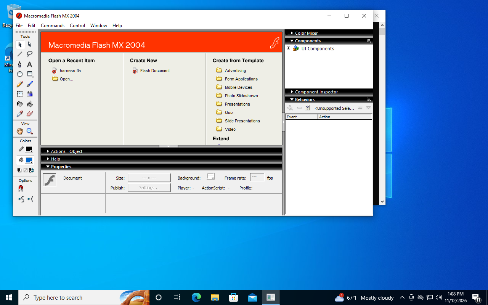

# Macromedia Flash MX 2004 — Static Recompilation

Static recompilation of **Macromedia Flash MX 2004** (Macromedia, 2004), the
Flash 7 authoring tool, from its shipping Win32 executable, `Flash.exe` 7.2
(VC++ 7.1, MFC 7.1 linked in), to native C. pcrecomp lifts `Flash.exe` to C,
MSVC compiles it, and pcrecomp's `native32` host runs it; the DLLs Flash loads
(xerces, GDI+, MSLU, the Macromedia licensing client) run natively through the
host's bridge. Licensing is never faked: the recomp runs against a real
install, activated with your own serial, and passes Flash's own licensing and
anti-debug checks by running them faithfully.

Built on the [pcrecomp](https://github.com/sp00nznet/pcrecomp) toolchain, on
its `main` branch, and following its
shared house style like the other
[pcrecomp projects](https://github.com/sp00nznet/pcrecomp#the-projects-that-built-this).

## Getting Started

You need **your own copy** of Macromedia Flash MX 2004, installed and
activated with **your own serial** (or running its 30-day trial). Nothing
from Flash, and no serial, is in this repository or downloaded for you;
everything is built on your machine from your installed copy.

Flash's installer sets up a licensing service, so do this **in a throwaway
Windows VM**:

1. Install Flash MX 2004 from your own disc and activate it with your own
   serial (Flash's activation dialog, "I have a serial number"), or use the
   trial. To type the serial by script instead, set `FLASH_SERIAL` (and
   `FLASH_PREV_SERIAL` for an upgrade serial) and run `tools\vm\serial.ps1`
   on that page; it is never stored, logged or screenshotted.
2. Download this repository (the green **Code** button, then **Download
   ZIP**) and unzip it somewhere with 6 GB free.
3. Double-click **`Setup.cmd`**. It asks before installing anything (Python,
   pefile and capstone, the Visual Studio 2022 Build Tools), fetches pcrecomp
   `main` beside this folder, finds Flash, catalogs,
   lifts and builds `build\flashmxrecomp.exe`, and leaves a
   `Flash MX 2004` shortcut here. About an hour; a rerun skips finished steps.

Setup never asks for or handles a serial: activation is Flash's own, done
before step 3. There is no installer release yet, and no `setup.sh` build:
the recomp needs Flash's licensing service, which only a Windows install has
(`./setup.sh` says so and exits). Building by hand is in
**[docs/building.md](docs/building.md)**.

## Status

**v0.2.0, alpha.** On a licensed install the recomp passes Flash's licensing
and anti-debug checks, opens the authoring window, and runs JSFL end to end.
The harness proves one thing so far: a test document exported to `.swf` by
the recomp is **byte-identical** to the original Flash.exe's.

| | |
|---|---|
| Functions found (`disasm32`) | 34,229 (86.5% of the code) |
| Lifted to C | 119,767, 0 errors |
| Imports bound | 698, 0 unresolved |
| Conformance (`.swf` vs the original's) | 1 of 1 identical (SHA-256 `7C908BA3…EBE81302`, no original Flash.exe running) |

Only one document is in the corpus, and the window, menus and tools have
been seen, not driven. [bringup.md](docs/bringup.md) is the log of each wall
and its fix, and [ROADMAP.md](ROADMAP.md) what comes next.

## Screenshots

The authoring window, running as recompiled code on the licensed install:

## Documentation

- [docs/building.md](docs/building.md): building by hand, the toolkit branch, the command line
- [docs/testing.md](docs/testing.md): the `.swf` conformance harness and the VM scripts
- [docs/bringup.md](docs/bringup.md): the binary, how licensing got through, every wall so far
- [ROADMAP.md](ROADMAP.md), [CHANGELOG.md](CHANGELOG.md), [CONTRIBUTING.md](CONTRIBUTING.md)

## Contributors

See **[CONTRIBUTORS.md](CONTRIBUTORS.md)** for who did what.

## License

MIT for this repository's own code ([LICENSE](LICENSE)). Flash MX 2004 is
© 2004 Macromedia, Inc. (now Adobe); none of its files, no serial, and
nothing generated from it is in this repository ([NOTICE.md](NOTICE.md)).
